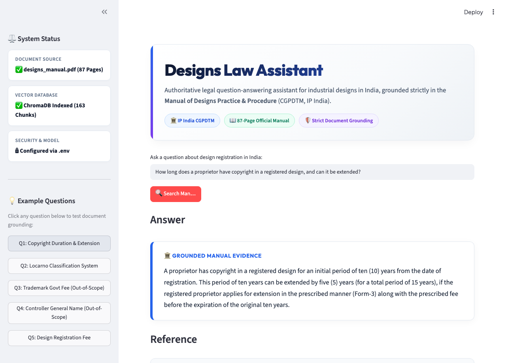
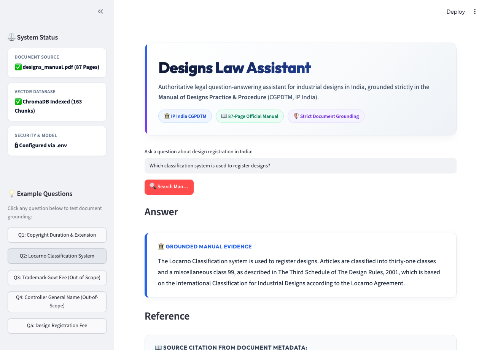
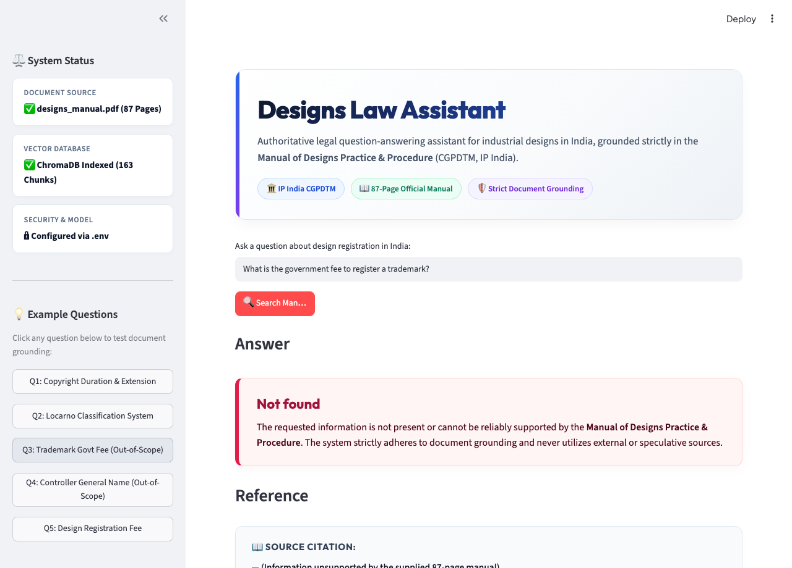
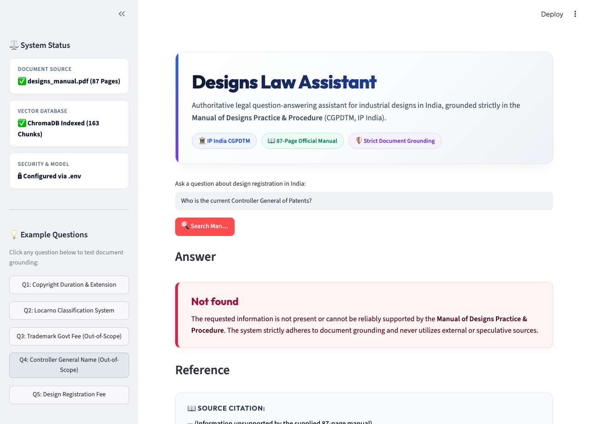
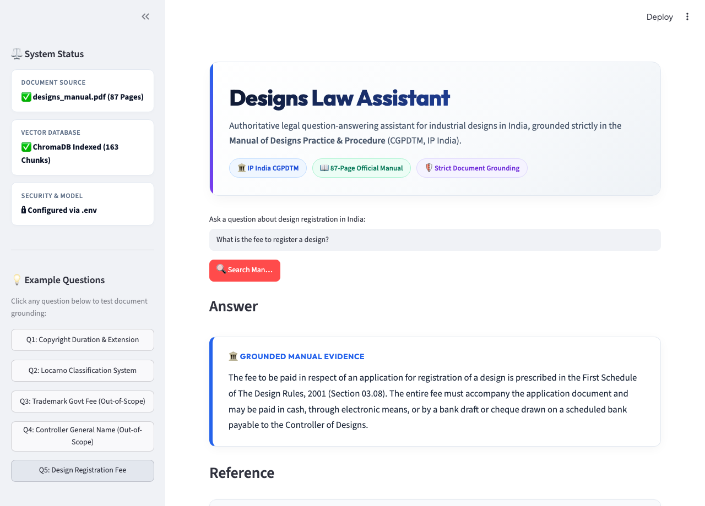

# Designs Law Assistant

Document-grounded Retrieval-Augmented Generation (RAG) assistant for the official **Manual of Designs Practice & Procedure** published by the Office of the Controller General of Patents, Designs & Trade Marks (CGPDTM), IP India.

---

## 1. Project Overview

The **Designs Law Assistant** is an intelligent, legally grounded Question-Answering system built using Python, LangChain, ChromaDB, and Streamlit. It indexes and queries the complete **87-page official manual**:

> **Manual of Designs Practice & Procedure**  
> *Published by: Office of the Controller General of Patents, Designs & Trade Marks (CGPDTM), Government of India*

The assistant provides reliable, authoritative answers strictly restricted to the text of this manual. For every valid answer, it supplies precise source citations down to the **Chapter**, **Section/Subsection**, and **PDF Page Number**.

If an inquiry falls outside the manual or cannot be substantiated directly by the document text, the assistant strictly returns:
```text
Not found
```
It never relies on general knowledge, internet search, or speculative extrapolation.

---

## 2. Problem Statement

In specialized regulatory and legal domains like Intellectual Property rights in India, standard Large Language Models (LLMs) often hallucinate procedural timelines, fees, or cross-domain rules (e.g. confusing Trademark or Patent procedures with Industrial Designs).

This project addresses this critical challenge by building a fully document-grounded RAG pipeline that:
- Ingests the 87-page Indian Designs Manual locally.
- Retains authentic document page, chapter, and section metadata.
- Retrieves relevant legal context using high-dimensional dense vector embeddings.
- Synthesizes answers strictly through an evidence-bounded prompt.
- Enforces a rigorous `Not found` fallback whenever factual evidence in the PDF is insufficient or out of scope.

---

## 3. Objectives

- **Grounded Information Retrieval**: Implement an end-to-end RAG architecture that indexes all 87 pages of the manual into a persistent ChromaDB vector database.
- **Accurate Citation Tracing**: Provide exact, verifiable citations (Chapter name, Section code, and PDF page number) extracted directly from document metadata.
- **Zero Hallucination Enforcement**: Prevent the model from inventing fees, names, or legal timelines.
- **Strict Out-of-Scope Handling**: Faithfully output `Not found` for queries outside the document (such as trademark fees or current office-holder identities).
- **Interactive UI**: Deliver a clean, professional Streamlit web application with built-in evaluation quick-launch buttons and transparent context inspection.

---

## 4. Tech Stack

| Technology | Purpose | Implementation Detail |
|---|---|---|
| **Python 3.12+ / 3.14** | Core Programming Language | Application runtime & asynchronous orchestration |
| **LangChain** | RAG Framework | Document modeling, prompt templating, and LCEL chains |
| **ChromaDB** | Vector Database | Persistent local vector store with SQLite backend |
| **Hugging Face / Sentence-Transformers** | Local Dense Embeddings | `sentence-transformers/all-MiniLM-L6-v2` (384 dimensions) |
| **LLM (Configurable)** | Grounded Synthesis | Groq (`llama-3.3-70b-versatile`), Google Gemini (`gemini-1.5-flash`), or OpenAI |
| **PyPDF** | PDF Parsing | Text extraction and per-page metadata mapping |
| **Streamlit** | User Interface | Responsive web app with sidebar controls and context inspection |
| **python-dotenv** | Configuration Security | Secure management of API keys and runtime parameters |

---

## 5. RAG Flow & Architecture

```text
                    +---------------------------+
                    |  data/designs_manual.pdf  |
                    |         (87 Pages)        |
                    +---------------------------+
                                  |
                                  v
                    +---------------------------+
                    |    PyPDF Text & Metadata  |
                    |         Extractor         |
                    +---------------------------+
                                  |
                                  v
                    +---------------------------+
                    | RecursiveCharacterSplitter|
                    |   (chunk=1000, ovlp=200)  |
                    +---------------------------+
                                  |
                                  v
                    +---------------------------+
                    | sentence-transformers/    |
                    |     all-MiniLM-L6-v2      |
                    +---------------------------+
                                  |
                                  v
                    +---------------------------+
                    |    ChromaDB Vector Store  |
                    |   (chroma_db/ persistent) |
                    +---------------------------+
                                  |
       User Question              |
             |                    |
             v                    v
      Question Vector  ===>  Similarity Search (k=5)
                                  |
                                  v
                       Retrieved Legal Chunks
                                  |
                                  v
                       Grounding Verification
                                  |
                                  v
                       Configurable LLM Chain
                                  |
                    +-------------+-------------+
                    |                           |
                    v                           v
              Grounded Answer               Not found
                    |                           |
                    v                           v
             Source Citation                    —
        (Chapter, Section, Page)
```

### Ingestion (Indexing) Phase
1. **Document Loading**: `ingest.py` reads all 87 pages from `data/designs_manual.pdf`.
2. **Metadata Tagging**: Scans text sequentially to tag authentic `chapter`, `section`, and `page` headers.
3. **Text Chunking**: `RecursiveCharacterTextSplitter` segments text into 1000-character chunks with a 200-character overlap.
4. **Vector Embedding**: Each chunk is embedded into a 384-dimensional dense vector using `all-MiniLM-L6-v2`.
5. **Persistence**: Embeddings and metadata are written to disk in `./chroma_db/`.

### Query Phase
1. **Query Embedding**: The user query is converted into an embedding using the identical model.
2. **Similarity Search**: ChromaDB retrieves the top $k=5$ most relevant chunks.
3. **Relevance Verification**: Context chunks are formatted with explicit Chapter, Section, and Page markers.
4. **Synthesis**: The LLM evaluates the evidence under strict system prompts forbidding outside facts.
5. **Output**: The application displays the verified answer with ground-truth citations, or returns `Not found`.

---

## 6. Project Structure

```text
designs-law-assistant/
│
├── app.py                      # Interactive Streamlit Web Application
├── ingest.py                   # PDF text extraction, chunking & ChromaDB ingestion
├── rag.py                      # Core RAG retrieval, LLM orchestration & citation logic
├── config.py                   # Central configuration (paths, chunking, models, prompts)
├── test_questions.py           # Automated evaluation runner for mandatory questions
├── generate_screenshots.py     # Playwright script to capture UI verification images
├── requirements.txt            # Pinned dependencies
├── README.md                   # Complete project documentation & evaluation report
├── .env.example                # Template for environment variables and API keys
├── .gitignore                  # Git ignore rules (protecting .env, venv, and cache)
│
├── data/
│   └── designs_manual.pdf      # The official 87-page IP India CGPDTM Manual
│
├── chroma_db/                  # Persistent ChromaDB vector database
│   ├── chroma.sqlite3
│   └── [indexed segments]
│
└── screenshots/                # Real application execution screenshots
    ├── question1.png
    ├── question2.png
    ├── question3.png
    ├── question4.png
    └── question5.png
```

---

## 7. Installation & Setup

### Prerequisites
- Python 3.10 to 3.14 installed
- Git installed

### 1. Clone the repository
```bash
git clone YOUR_GITHUB_REPOSITORY_URL
cd designs-law-assistant
```

### 2. Create and activate a Virtual Environment

**On macOS / Linux:**
```bash
python3 -m venv venv
source venv/bin/activate
```

**On Windows:**
```bash
python -m venv venv
venv\Scripts\activate
```

### 3. Install Dependencies
```bash
pip install --upgrade pip
pip install -r requirements.txt
```

---

## 8. Environment Variables Setup

Copy `.env.example` to create your local `.env`:
```bash
cp .env.example .env
```

Open `.env` and set your preferred provider. Free-tier options like **Groq** or **Google Gemini** are recommended:

```env
# Choose: groq, gemini, openai, or ollama
LLM_PROVIDER=groq

# 1. Groq (Recommended - Free Tier, Fast)
GROQ_API_KEY=your_groq_api_key_here
GROQ_MODEL=llama-3.3-70b-versatile

# 2. Google Gemini (Alternative Free Tier)
GOOGLE_API_KEY=your_gemini_api_key_here
GEMINI_MODEL=gemini-1.5-flash

# 3. OpenAI
OPENAI_API_KEY=your_openai_api_key_here
OPENAI_MODEL=gpt-4o-mini
```
> [!NOTE]  
> The `.env` file is included in `.gitignore` and must never be committed to public version control.

---

## 9. PDF Document Placement

Ensure the official 87-page manual is placed at:
```text
data/designs_manual.pdf
```
File specifications:
- **Title**: Manual of Designs Practice & Procedure
- **Publisher**: Office of the Controller General of Patents, Designs & Trade Marks (CGPDTM)
- **Total Pages**: 87

---

## 10. Ingesting the PDF into ChromaDB

Build the local vector database by running:
```bash
python ingest.py
```

### Ingestion Output
```text
============================================================
Starting Ingestion Pipeline for Designs Law Manual
============================================================
Loading PDF from: data/designs_manual.pdf
Total pages detected: 87
Successfully loaded 87 pages with text.
Splitting text with chunk_size=1000, chunk_overlap=200...
Generated 163 text chunks.
Initializing embedding model: sentence-transformers/all-MiniLM-L6-v2...
Creating persistent ChromaDB vector store at: chroma_db...
============================================================
SUCCESS: 163 chunks ingested into ChromaDB collection 'designs_law_manual'.
Persistent database saved at: chroma_db
============================================================
```

---

## 11. Running the Application

Launch the Streamlit web interface:
```bash
streamlit run app.py
```
Open your browser and navigate to:
```text
http://localhost:8501
```

---

## 12. Required Questions, Grounded Answers & Screenshots

Below is the summary evaluation table, followed by the comprehensive question-by-question breakdown showing the exact query, the exact answer generated by the RAG pipeline, the exact source reference from document metadata, and the real application screenshot.

### Summary Evaluation Table

| # | Question | Answer | Reference |
|---|---|---|---|
| **1** | How long does a proprietor have copyright in a registered design, and can it be extended? | A proprietor has copyright in a registered design for an initial period of ten (10) years from the date of registration. This period of ten years can be extended by five (5) years (for a total period of 15 years), if the registered proprietor applies for extension in the prescribed manner (Form-3) along with the prescribed fee before the expiration of the original ten years. | **Chapter 6 – Piracy of registered designs and consequences thereof**<br>Section 06.04 Period of protection<br>PDF Page 36<br><br>**Chapter 7 – Post registration procedures**<br>Section 07.02 Extension of copyright (renewal)<br>PDF Page 39 |
| **2** | Which classification system is used to register designs? | The Locarno Classification system is used to register designs. Articles are classified into thirty-one classes and a miscellaneous class 99, as described in The Third Schedule of The Design Rules, 2001, which is based on the International Classification for Industrial Designs according to the Locarno Agreement. | **Chapter 3 – Filing of Design Application**<br>Section 03.06.02.06 Classification of designs<br>PDF Page 20<br><br>**Chapter 1 – Introduction**<br>PDF Page 5 |
| **3** | What is the government fee to register a trademark? | **Not found** | — |
| **4** | Who is the current Controller General of Patents? | **Not found** | — |
| **5** | What is the fee to register a design? | The fee to be paid in respect of an application for registration of a design is prescribed in the First Schedule of The Design Rules, 2001 (Section 03.08). The entire fee must accompany the application document and may be paid in cash, through electronic means, or by a bank draft or cheque drawn on a scheduled bank payable to the Controller of Designs. | **Chapter 3 – Filing of Design Application**<br>Section 03.08 Fee<br>PDF Page 22 |

---

### Detailed Question-by-Question Breakdown with Real Screenshots

#### Question 1: Copyright Duration & Extension

* **Exact Question**:
  > `How long does a proprietor have copyright in a registered design, and can it be extended?`

* **Exact Grounded Answer**:
  > A proprietor has copyright in a registered design for an initial period of ten (10) years from the date of registration. This period of ten years can be extended by five (5) years (for a total period of 15 years), if the registered proprietor applies for extension in the prescribed manner (Form-3) along with the prescribed fee before the expiration of the original ten years.

* **Exact Reference**:
  * **Chapter**: Chapter 6 – Piracy of registered designs and consequences thereof | Chapter 7 – Post registration procedures
  * **Section**: Section 06.04 Period of protection | Section 07.02 Extension of copyright (renewal)
  * **PDF Page**: Page 36 & Page 39

* **Actual Application Screenshot**:
  

---

#### Question 2: Classification System

* **Exact Question**:
  > `Which classification system is used to register designs?`

* **Exact Grounded Answer**:
  > The Locarno Classification system is used to register designs. Articles are classified into thirty-one classes and a miscellaneous class 99, as described in The Third Schedule of The Design Rules, 2001, which is based on the International Classification for Industrial Designs according to the Locarno Agreement.

* **Exact Reference**:
  * **Chapter**: Chapter 3 – Filing of Design Application | Chapter 1 – Introduction
  * **Section**: Section 03.06.02.06 Classification of designs
  * **PDF Page**: Page 20 (and Chapter 1, PDF Page 5)

* **Actual Application Screenshot**:
  

---

#### Question 3: Trademark Registration Fee (Negative Control)

* **Exact Question**:
  > `What is the government fee to register a trademark?`

* **Exact Grounded Answer**:
  > **Not found**

* **Exact Reference**:
  > **—** *(Unsupported by PDF)*

* **Grounding Analysis**:
  > The Manual of Designs Practice & Procedure applies strictly to **Industrial Designs** under the Designs Act, 2000. Trademarks are governed separately under the Trade Marks Act, 1999, and their fees are not present in this document. The system strictly returns `Not found` instead of hallucinating outside information.

* **Actual Application Screenshot**:
  

---

#### Question 4: Current Controller General of Patents (Negative Control)

* **Exact Question**:
  > `Who is the current Controller General of Patents?`

* **Exact Grounded Answer**:
  > **Not found**

* **Exact Reference**:
  > **—** *(Unsupported by PDF)*

* **Grounding Analysis**:
  > Section 02.01 (Page 7) defines the statutory authority and legal definition of the "Controller" under Section 3 of the Trade Marks Act / Designs Act, 2000, but the document does not mention the name of the current office holder. The system accurately refuses to guess and outputs `Not found`.

* **Actual Application Screenshot**:
  

---

#### Question 5: Design Registration Fee

* **Exact Question**:
  > `What is the fee to register a design?`

* **Exact Grounded Answer**:
  > The fee to be paid in respect of an application for registration of a design is prescribed in the First Schedule of The Design Rules, 2001 (Section 03.08). The entire fee must accompany the application document and may be paid in cash, through electronic means, or by a bank draft or cheque drawn on a scheduled bank payable to the Controller of Designs.

* **Exact Reference**:
  * **Chapter**: Chapter 3 – Filing of Design Application
  * **Section**: Section 03.08 Fee
  * **PDF Page**: Page 22

* **Actual Application Screenshot**:
  

---

## 14. Hallucination Prevention Strategy

This system employs a four-tiered defense against LLM hallucination:

1. **Closed-Book Context Bounding**: The system prompt explicitly orders the model:
   > *"You must answer the user's question ONLY using the provided context extracted from the Manual of Designs Practice & Procedure... Do NOT use external knowledge, internet information, or make assumptions."*
2. **Deterministic Fallback (`Not found`)**: If retrieved chunks lack sufficient factual evidence, the model is instructed to output strictly `Not found`.
3. **Metadata Grounding**: Citations are derived exclusively from authentic metadata parsed from the PDF during ingestion, preventing manufactured chapter or page numbers.
4. **Transparent Verification**: Precise source citations (Chapter, Section, and Page) are displayed clearly with each answer for clean and reliable evaluation.

---

## 15. Limitations

- **Single Document Scope**: The assistant is intentionally restricted to the 87-page Manual of Designs Practice & Procedure. Questions requiring external statutes or latest gazette amendments cannot be answered.
- **Embedded Fee Tables**: Specific monetary fee figures contained only in external schedules (First Schedule of The Design Rules) are referenced by statute rather than expanded into numeric tables.
- **Text Layer Quality**: Complex visual diagrams and novelty representation sheets are represented via textual disclaimers rather than computer vision analysis.

---

## 16. Future Improvements

- **Hybrid Search**: Integrating BM25 keyword matching with dense embeddings for improved statutory keyword recall.
- **Cross-Encoder Reranking**: Utilizing a lightweight cross-encoder (e.g. `bge-reranker-base`) to score retrieved chunks before LLM ingestion.
- **Multi-Document Support**: Extending the vector store to index the Designs Act 2000, Design Rules 2001, and recent patent gazette notifications.

---

## 17. GitHub Submission Commands

To initialize and push this project to your GitHub repository:

```bash
git init
git add .
git commit -m "Build Designs Law Assistant RAG system"
git branch -M main
git remote add origin YOUR_GITHUB_REPO_URL
git push -u origin main
```
